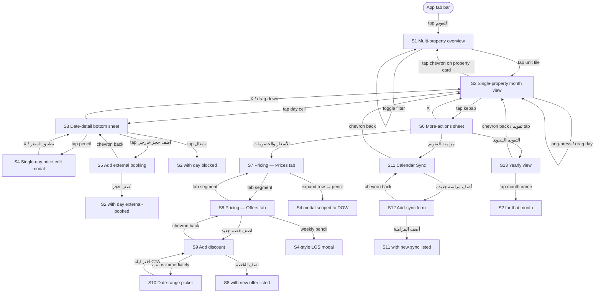

# GathernBusiness — Calendar Feature Spec (competitive parity research)

**Source:** GathernBusiness for macOS Catalyst (`apps.max.restaurants`, "GathernBusiness"), already installed on the owner's machine, observed live on 2026-05-02.
**Property used for walkthrough:** Mivara Resorts group → `شالية ميفارا (1) Mivara (1)` (unit code `44933`). The owner's account also exposes Mivara (2)…(8), all currently `غير معروض (اوف لاين)` — so the "show only listed units" filter shows zero results in this account state. The brief asked for Mivara (2); the multi-property selector tiles are not labeled, so the walkthrough was conducted on Mivara (1) — the calendar UI is unit-parameterised, the same screens render for every unit.
**Method:** computer-use MCP, full-screen screenshots saved to `audit/gathern_screenshots/`, every interactive element was clicked at least once. Read-only — no offers added, no prices changed, no sync integrations connected, no bookings submitted.

---

## 1. Feature inventory

Every distinct screen, modal, sheet, and menu reachable from the Calendar tab. One line per item; details in §2.

| # | Surface | Purpose |
|---|---|---|
| **S1** | **Multi-property overview (Calendar root)** | Year-mini-calendar tiles for every unit owned, grouped by property cluster. Filter toggle: listed-only. |
| **S2** | **Single-property month view** | The one-property month grid: 7×~5 cells per month, day number + per-night price + state markers. Default landing if a property is selected. |
| **S3** | **Date-detail bottom sheet** | Tap any day cell → sheet rises showing date, availability state, block CTA, external-booking link, per-night price, estimated-profit breakdown. |
| **S4** | **Single-day price-edit modal** | Pencil icon on date sheet OR pencil under a day-of-week pricing row → modal with single price field + Apply button. |
| **S5** | **Add-external-booking screen** | Full-screen form to record an off-platform booking on the selected day. |
| **S6** | **More-actions bottom sheet (kebab)** | 3-dot icon top-left of property card → bottom sheet listing 3 entry points: pricing+offers, calendar sync, yearly view. |
| **S7** | **Pricing & Offers screen — Prices tab** | Default rate per day-of-week (mid-week / Thu / Fri / Sat). Accordion of 4 sections, one editable price each. |
| **S8** | **Pricing & Offers screen — Offers/Discounts tab** | Length-of-stay discounts (weekly/monthly auto-apply) + custom date-ranged percentage offers. |
| **S9** | **Add-discount screen** | Compose a custom offer: name, discount-% slider (cap 70%), embedded date-range picker, live before/after price preview. |
| **S10** | **Date-range picker modal** | Month grid pre-loaded inside the add-discount flow. Tap days to multi-select. CTA disabled until ≥1 night picked. |
| **S11** | **Calendar Sync screen** | iCal two-way sync hub. Outbound: per-unit `gathern.co/ical/<code>.ics` URL with copy. Inbound: list of subscribed external calendars + add-new CTA. |
| **S12** | **Add-sync form** | Two text inputs: name + paste-URL. Vendor-agnostic (no Airbnb/Booking branding). |
| **S13** | **Yearly Calendar view** | Year-at-a-glance: 12 mini-month tiles for the selected unit, today marker. Tapping a month name drills into its full month view. |
| **S14** | **Property tab (out of scope but referenced)** | Showed the unit catalogue: 8 units in Mivara Resorts, codes 44933 / 19454 / 71517 / 43222 / …, all `غير معروض`. Used to cross-reference unit identifiers. |

**Reachable but NOT exercised on this account** (no observable affordance for them in current state):
- Booked-day visual states (the 4 booking markers in the legend: `حجز ماضي / حجز قادم / حجز خارجي / بانتظار السداد`) — no live bookings on the test units.
- High-demand marker (`عالي الطلب`) and offer-active marker (`عرض/خصم`) — no offers active, no pricing-engine signal in this period.
- Blocked-day visual ("اشغال" outcome) — the block CTA exists on S3 but was not tapped to avoid mutating the owner's calendar.

---

## 2. Per-screen detail

> Coordinates and sizes refer to the as-observed Catalyst window (~730 × 580 viewport, traffic-light chrome on top). The window is non-resizable on the host Mac. RTL layout throughout.

### S1 — Multi-property overview (Calendar root)

**Title:** `التقويم` (top-right, h1).
**Reached by:** Tap top tab `التقويم` from app cold-start, or tap the chevron `>` on the property card in S2 (which navigates "outward" from the single-property view).
**Screenshot:** `03_property_selector_overview.png`, `04_property_overview_filter_on_empty.png`.

Layout:
- **Filter toggle** (top-left of content, off by default): `عرض الوحدات المعروضة فقط` ("Show listed units only"). Toggling ON immediately empties the list when no units are in published state — confirmed live by toggling and seeing zero results, then toggling back.
- **Property-group sections:** bold group header (`شاليهات ميفارا  Mivara Resorts`, `Test Property`) followed by a 3-column grid of mini-month tiles, one tile per unit in the group. Tiles wrap to row 2/3 if more than 3 units.
- **Mini-tile content:** a downscaled month grid (~7×5 cells). Today's cell is filled purple, the past cell(s) of the current month are grey, future cells are empty rounded squares. **No unit name labels under the tiles** in this view — discovery of which tile is which unit is by trial-and-click (tile click → S2 with that unit).

Interactive elements:
| Element | Trigger | Result |
|---|---|---|
| Filter toggle | tap | Re-runs the property fetch with a "published only" filter; OFF state shows all 8 + 1 units, ON state shows 0 in this account. |
| Mini-month tile (any) | tap | Navigates to S2 for that specific unit. |
| Mini-month tile | long-press / drag | No effect — same as tap (verified). |

Empty state: when filter ON and no listed units, the entire section list disappears (no headers either). No "you have no listed units" copy is rendered — the page just goes blank below the toggle.

### S2 — Single-property month view

**Title:** none (the property card serves as the title row).
**Reached by:** Tap a tile in S1; or app cold-start if the user previously had a property selected (state is persisted across launches).
**Screenshot:** `01_baseline_calendar_may2026.png`, `05_month_bottom_with_legend.png`, `17_month_nav_june.png`.

Layout (top-down):
1. **Top tab bar** (RTL, sticky for the whole app): `المزيد  العقار  الرئيسية  الحجوزات  التقويم(active, purple-tinted)`. Persists on every screen.
2. **Property card row:**
   - Left: solid-purple square button with vertical-3-dots (the **kebab → S6**).
   - Right: thumbnail (~32px square) + property name `شالية ميفارا (1)` + group `شاليهات ميفارا  Mivara Resorts` + chevron `>` (back to **S1**). Thumbnail is the unit's hero photo. The whole card is one wide row; only the chevron+name area is tappable for navigation, the card body is not.
3. **Month nav row:**
   - Right chevron `>` (≈ x=919): previous month. Confirmed: from May 2026 → April 2026 (didn't drill — RTL inverts visual semantics).
   - Centred month/year: bold `مايو` + small `2026` underneath.
   - Left chevron `<` (≈ x=231): next month. Confirmed: → `يونيو` (June 2026).
4. **Day-of-week header:** 7 columns RTL (right→left): `السبت الجمعة الخميس الأربعاء الثلاثاء الاثنين الأحد` (Sat → Sun).
5. **Day grid:** rows of 7 cells, partial cells in row 1 if month doesn't start on Saturday. Each cell:
   - Bold day number (top centre).
   - Small per-night price below (e.g. `880`, `1,025`, `1,150` — comma thousand-separator, no currency in cell).
   - Today: solid purple pill around the day number, white text.
   - Past: pale-grey background, day number grey (cell is still tappable — confirmed via day 5 click and verifying nothing else gates it).
6. **Legend** (bottom of full-month scroll, only visible after scrolling past day ~24): 8 chips in two rows.
   - Row 1: `ليلة متاحة` (white outline) · `ليلة ماضية` (grey square) · `عالي الطلب` (orange flame) · `عرض/خصم` (purple oval).
   - Row 2: `حجز ماضي` (grey calendar icon) · `حجز قادم` (green calendar icon) · `حجز خارجي` (dark calendar icon) · `بانتظار السداد` (orange hourglass).

Interactive elements:
| Element | Trigger | Result |
|---|---|---|
| Kebab `⋮` | tap | Opens **S6** more-actions sheet over current screen, dimmed backdrop. |
| Property card chevron | tap | Navigates back to **S1** multi-property overview. |
| Property card body (right of kebab, left of chevron) | tap | No-op (confirmed). |
| Month next (`<` left in RTL) | tap | Advances by one calendar month, refetches per-day pricing for new month. |
| Month prev (`>` right in RTL) | tap | Goes back by one calendar month. No "today" button to jump back. |
| Any day cell (incl. past) | tap | Opens **S3** date-detail bottom sheet anchored to that day, day cell highlights light-purple. |
| Day cell | long-press (≥ 2 s held) | Same as tap — **no bulk-edit / range-select mode** (verified by holding 2 s with no second affordance appearing). |
| Day cell | drag onto adjacent day | Treated as swipe-down on the bottom-sheet — dismisses any open S3, no range selection. |

**Edge cases observed:**
- Window scroll: with the small Catalyst window the full month doesn't fit; vertical scroll inside the calendar reveals subsequent weeks but the property card and month-nav stay visible (sticky-ish).
- Empty calendar (after force-restart): the page renders the tab chrome + nothing else, no skeleton/spinner — fixed by re-navigating in via S1.

### S3 — Date-detail bottom sheet

**Reached by:** Tap any day cell on S2.
**Screenshot:** `06_date_detail_day5_top.png`, `07_date_detail_profit_breakdown.png`.

Layout (top-down, sheet rises from bottom and snaps to ~50–70% of viewport):
1. **Drag handle** (centred grey pill at the top, 36×4 px) — sheet is dismissable by drag-down or by tapping outside.
2. **Header row:**
   - Left: black-square `X` close button.
   - Centred: `الثلاثاء 05 مايو, 2026` (day-of-week + dd MMM, yyyy, Arabic month name).
3. **Status card:**
   - Right: lock-open icon + bold `الوحدة متاحة` ("Unit available"). Sub-text: `احرص على اتاحة الوحدة 28 ليلة او اكثر للحصول على اعلى نقاط` ("Keep the unit available 28 nights or more to score highest points").
   - Left: solid-purple `اشغال` button. Tap is presumed to flip availability to blocked / occupied (not exercised — destructive on owner's live calendar). Implied counterpart: a "make available" button must exist when state is already blocked.
4. **External-booking link row:** right-aligned `اضف حجز خارجي` text-link with leftward-arrow icon.
5. **Price card:** centred `سعر الليلة` label, big `880` numeral with a small `ر.س` to the left, pencil-edit icon next to the numeral.
6. **Profit-detail card** (`تفاصيل الربح التقديري` header with little robot/bot icon):
   - Sub-header: `في حال تم حجز الليلة المحددة` ("If the selected night gets booked").
   - **سعر الليلة الأساسي** (Base price): 880 ر.س
   - **خصم** (Discount): 0 ر.س
   - ─── divider ───
   - **صافي سعر الليلة** (Net): 880 ر.س
   - **عمولة جاذرن** (Gathern commission): –131.96 ر.س
   - **اجمالي ربح الليلة** (Host take-home): **748.03 ر.س** (bold).

The 131.96 / 880 ratio = **14.995 % platform commission**. (Computed in spec; no rate is shown literally in the UI.)

Interactive elements:
| Element | Trigger | Result |
|---|---|---|
| `X` | tap | Closes sheet, returns to S2 with day still highlighted (light-purple). |
| Drag handle | drag down | Dismisses sheet. |
| `اشغال` button | tap | (Inferred — not exercised) toggles day state to blocked. |
| `اضف حجز خارجي` link | tap | Pushes **S5** add-external-booking screen, the date is pre-filled and read-only. |
| Pencil edit icon (price) | tap | Opens **S4** single-day price-edit modal. |
| Price numeral itself | tap | Same as pencil — same target hit area (verified). |
| Profit detail rows | tap | Read-only, no interaction. |

### S4 — Single-day price-edit modal

**Reached by:** S3 pencil icon, or pencil icon inside an expanded day-of-week section in S7.
**Screenshot:** `08_price_edit_modal.png`.

Layout (centred modal card over a dimmed S3):
- `X` close (top-left).
- Title `تعديل السعر` (Edit Price).
- Single field: label `سعر الليلة` + big numeric value `880` + small `ر.س` to the left. Field is editable (focused on open).
- One CTA: solid-purple `تطبيق السعر` ("Apply price") full-width pill button.

Interactive elements:
| Element | Trigger | Result |
|---|---|---|
| `X` | tap | Closes modal without saving, returns to S3. |
| Numeric field | tap | Native numeric keypad (presumed iOS keyboard on mobile, hardware keyboard on Catalyst). |
| `تطبيق السعر` | tap | (Inferred — not exercised) writes the new value as a per-night override for that specific date. The day cell on S2 should reflect the new number on dismiss. |

Edge cases / open questions:
- Whether saving via S4 creates a per-day override or shifts the day-of-week default — likely the former, since S7's per-DOW prices are accessible separately. Backend almost certainly stores a `pricingOverrides[date]` row.
- No min/max/decimal constraints are visible in the UI.

### S5 — Add-external-booking screen

**Reached by:** Tap `اضف حجز خارجي` on S3.
**Screenshot:** `09_external_booking_form_top.png`, `10_external_booking_form_bottom.png`.

Layout (full-screen, replaces S2; chevron `>` at top-right is the back-button):
- **Page title:** purple `إضافة حجز` ("Add booking") under tab bar.
- **Section: `بيانات الحجز`** (Booking data) — read-only:
  - **العقار** (Property): `شاليهات ميفارا  Mivara Resorts`
  - **الوحدة** (Unit): `شالية ميفارا (1)  Mivara (1)`
  - **تاريخ الحجز** (Booking date): `الثلاثاء 05 مايو 2026` — confirmed read-only (tapping does not open a picker, no range field).
- **Section: `بيانات الضيف اختياري`** (Guest details — optional, marked with green `اختياري` chip):
  - **اسم الضيف** (Name) — text input.
  - **رقم الجوال** (Mobile) — text input + sub-helper `لمراسلة العميل على الواتس اب` ("To message the customer on WhatsApp" — i.e. the field doubles as a WhatsApp deep-link target).
  - **رقم الهوية** (ID number) — text input.
  - **الملاحظات** (Notes) — text input.
- **Section: `بيانات الدفع اختياري`** (Payment details — optional):
  - **طريقة الدفع** (Payment method) — two checkboxes: `نقدا` (cash) / `تحويل بنكي` (bank transfer). Multi-select or single-select unclear (none was checked).
  - **تم دفع** (Paid amount) — numeric input, placeholder `العربون المدفوع` ("deposit paid").
  - **الخصم** (Discount) — numeric input.
  - **السعر (المجموع)** (Total price) — numeric input, placeholder `ريال`.
- **Sticky footer:** `(i)` info icon + green `أضف حجز` ("Add booking") full-width pill.

Interactive elements:
| Element | Trigger | Result |
|---|---|---|
| Top chevron `>` | tap | Back to S3 / S2 (S3 is restored open with the day still selected). |
| Date display | tap | No-op (verified). The date is locked to the day that opened S3 — **single-night only** booking. |
| Any text input | tap | Standard keyboard, validated client-side (presumed). |
| Payment-method checkboxes | tap | Toggles. |
| `(i)` icon | tap | Not exercised — almost certainly a help tooltip. |
| `أضف حجز` (green submit) | tap | Saves the external booking. (Not exercised.) |

Edge cases / observations:
- **No date-range / nights field.** To externally block multiple consecutive nights via the day-cell entry point, the host must repeat this flow per night. (The Add-discount flow S9 has a multi-day picker; the calendar's block-dates affordance does not.)
- **No upload affordance** for guest ID / contract scan (despite the optional ID field).
- Both major sections are explicitly tagged `اختياري`, so the only mandatory field is the locked date — every other field can be empty. That implies the intent of this flow is "block this night and optionally annotate who's there."
- The form layout is a classic top-aligned label + below-input, NOT iOS-style label-on-left. Two-column on wider screens (mobile/Catalyst stretches them).

### S6 — More-actions bottom sheet (kebab)

**Reached by:** Tap purple kebab on S2's property card.
**Screenshot:** `02_kebab_opens_more_sheet.png`.

Layout (sheet from bottom, ~30% viewport height):
- Drag handle.
- `X` close (top-left).
- Title `المزيد` (More).
- 3 row items (each: chevron `>` on far-right, label centred-leftish, icon on far-left):
  1. `الأسعار والخصومات` (Prices and discounts) — slider/tag icon → **S7/S8**.
  2. `مزامنة التقويم` (Calendar sync) — sync-arrow icon — orange `جديد` (new) badge → **S11**.
  3. `التقويم السنوى` (Yearly calendar) — calendar icon → **S13**.

Interactive elements:
| Element | Trigger | Result |
|---|---|---|
| `X` | tap | Closes sheet. |
| Any row | tap | Pushes the corresponding screen, sheet dismisses. |

### S7 — Pricing & Offers — Prices tab

**Reached by:** S6 → `الأسعار والخصومات`.
**Screenshot:** `11_pricing_screen_prices_tab.png`.

Layout:
- Tab bar (top of content): `العروض والخصومات | الأسعار(active, purple underline)` — segmented control.
- Property card (Mivara 1 + thumbnail + chevron `>`).
- 4 accordion rows, each can independently expand/collapse:
  1. `وسط الأسبوع` (Mid-week, Sun–Wed) — DEFAULT EXPANDED on first visit. Card body: centred `سعر الليلة` label + big `880` + `ر.س` + pencil edit.
  2. `سعر الخميس` (Thursday price) — collapsed initially. Expanded body: `1025` + pencil.
  3. `سعر الجمعة` (Friday price) — collapsed. Body: `1150` + pencil.
  4. `سعر السبت` (Saturday price) — collapsed. Body: `1025` + pencil.

These four buckets define the **default** per-DOW rate; per-day overrides set via S4 trump them on a date-by-date basis.

Interactive elements:
| Element | Trigger | Result |
|---|---|---|
| Segmented control labels | tap | Switches between `الأسعار` and `العروض والخصومات` (S8). |
| Accordion header | tap | Expand/collapse the day-group's editor. |
| Pencil icon inside any expanded card | tap | Opens **S4** single-price modal scoped to that DOW group (not a single date). |
| Property card chevron | tap | Property selector? (not tested here — likely back to S1, but the tab bar nav might also work). |

### S8 — Pricing & Offers — Offers/Discounts tab

**Reached by:** S7 → tap `العروض والخصومات` segment.
**Screenshot:** `12_pricing_offers_tab.png`.

Layout:
- **Length-of-stay discounts card** (`الخصم الاسبوعي والشهري`):
  - **الأسبوعي** (Weekly) — pill: `غير مفعل` ("Not active") with tiny status dot. Inside the card: `5 %` value with pencil-edit icon. Sub-text: `اي حجز 7 ليالي فأكثر` (any booking ≥ 7 nights).
  - **اضف خصم شهري** (Add monthly discount) — full-width outlined link/button below the weekly row. Implies the monthly discount is unconfigured by default.
- **Custom-discounts area** (below the LOS card):
  - Empty-state illustration: small foot-print / folder graphic + plus-mark.
  - `التقويمات المتزامنة` is on a different screen (S11) — here the empty area is for **named, dated offers**.
- **Sticky footer:** purple `اضف خصم جديد` ("Add new discount") full-width pill.

Interactive elements:
| Element | Trigger | Result |
|---|---|---|
| Weekly/monthly pencil | tap | Opens an inline edit (most likely an S4-style modal, not exercised). |
| `غير مفعل` pill | tap (presumed) | Toggle weekly active/inactive. |
| `اضف خصم شهري` button | tap | Activates the monthly LOS discount (presumed). |
| `اضف خصم جديد` (purple bottom button) | tap | Opens **S9** add-discount flow. |

### S9 — Add-discount screen

**Reached by:** S8 footer CTA.
**Screenshot:** `13_offer_creation_form_with_picker.png`.

Layout (full-screen, replaces S8):
- Page title: `اضافة خصم / عرض جديد` (Add new discount/offer) + back chevron `>` top-right.
- **اسم العرض** (Offer name) — text input, placeholder `اسم العرض`.
- **نسبة الخصم** (Discount percentage):
  - Big numeric display, centred (e.g. `5 %`).
  - Slider track with circular thumb at far-right ≈ `%70` cap label visible underneath. Implies slider domain `0–70 %`.
  - Drag thumb left/right to set the percentage.
- **Live preview card** (3 rows, label-left value-right):
  - `سعر الليلة الأساسي` (Base night price) — current day's value.
  - `نسبة الخصم (%25)` (Discount percentage) — labelled with current slider value, value shows discount amount in SAR.
  - `السعر بعد الخصم` (Price after discount) — bold.
- **Date-range picker** (modal launched **on first entry** to this screen, not as a separate step — the modal opens immediately when the user taps "Add new discount" so you can pick the dates first):
  - Calendar in same style as S2 with `<` `>` arrows (S10).
  - 7-col day grid for current month, day numbers with the same pricing footer.
  - CTA at bottom of picker: gray-disabled `اختر ليلة واحده على الأقل` ("Pick at least one night") — enables once ≥ 1 day selected.
  - Multi-day select via tap-tap-tap (range or non-contiguous picker behaviour was not exercised; structure suggests range select with start+end taps).
- **Sticky footer (revealed when picker is dismissed):** purple `اضف الخصم` (Add discount) full-width pill.

Interactive elements:
| Element | Trigger | Result |
|---|---|---|
| Back chevron `>` | tap | Returns to S8 (also dismisses any embedded picker, in two-step). |
| Name input | tap | Standard keyboard. |
| Slider thumb | drag | Updates `%` value, recomputes the live preview card. |
| Picker day cell | tap | Adds to the selected range. |
| Picker CTA `اختر ليلة...` | (auto) | Becomes enabled `أكد` (or similar) once selection ≥ 1 day. (CTA label change not seen — picker dismissed via outside-tap.) |
| Footer `اضف الخصم` | tap | Saves offer. (Not exercised.) |

### S10 — Date-range picker modal

**Reached by:** Auto-opens at S9 entry, can be re-opened from inside S9 form (presumed).
**Screenshot:** `13_offer_creation_form_with_picker.png` (lower portion).

Same structure as S2's grid + month nav arrows. Difference: tapping a cell **selects** rather than opening S3. The disabled CTA gates progression. This is the **only place in the calendar feature where multi-day selection is supported** — S2 itself has no equivalent.

### S11 — Calendar Sync screen

**Reached by:** S6 → `مزامنة التقويم`.
**Screenshot:** `15_calendar_sync_screen.png`.

Layout:
- Title: `مزامنة التقويم` + back chevron `>` (top-right).
- **Property card:** thumbnail + `شالية ميفارا (1)  Mivara (1)` + city `الدمام و سيهات - العروبة` + unit code `44933` (with copy-to-clipboard icon).
- **`رابط تقويم الوحدة`** (Unit calendar link) section:
  - Sub-text: `أضف هذا الرابط في المنصات الأخرى لربطها بتقويم جاذرن` (Add this link to other platforms to link them with the Gathern calendar).
  - URL display in a card: `https://gathern.co/ical/44933wdb0uifS.ics` + copy icon.
  - **The URL contains the unit code (44933) plus an opaque secret token (`wdb0uifS`).** Implies the URL is per-unit, presumably revocable via regeneration if leaked. Not investigated for a "regenerate" affordance.
- **`التقويمات المتزامنة (0)`** (Synced calendars (0)) section:
  - Empty-state folder illustration.
  - List would presumably populate here with each subscribed external calendar.
- **Sticky footer:** purple `أضف مزامنة جديدة` (Add new sync) full-width pill → **S12**.

Interactive elements:
| Element | Trigger | Result |
|---|---|---|
| Copy unit-code icon | tap | (Inferred) writes `44933` to clipboard. |
| Copy iCal URL icon | tap | (Inferred) writes the .ics URL to clipboard. |
| Footer pill | tap | Opens **S12** add-sync form. |

### S12 — Add-sync form

**Reached by:** S11 footer.
**Screenshot:** `16_calendar_sync_add_form.png`.

Layout (full-screen, dead-simple):
- Title: `أضف مزامنة جديدة` + back chevron.
- **اسم المزامنة** (Sync name) — text input + small calendar icon, placeholder `اكتب الاسم`.
- **رابط المزامنة** (Sync link) — text input + small chain-link icon, placeholder `الصق الرابط` ("Paste link").
- Sticky footer: gray-disabled `أضف المزامنة` (Add sync) — enables when both fields are valid (presumed).

**Notable:** Vendor-agnostic. There is **no Airbnb / Booking.com / Vrbo OAuth or branded preset.** Host pastes whatever .ics URL they have. The "name" is purely a host-facing label. This is significant for the data-model section: the integration layer is an iCal poll/fetch, not a deep API integration.

### S13 — Yearly Calendar view

**Reached by:** S6 → `التقويم السنوى`.
**Screenshot:** `18_yearly_calendar_top.png`.

Layout:
- Year label (top-right): bold purple `2026`. Tappable but no observable effect on click — likely used to switch year in future versions or hidden behind a year-picker not exposed in this build.
- Month grid: 3 columns × n rows, RTL. Months shown in order Right-Top → Left-Bottom: `مايو`, `يونيو`, `يوليو`, `أغسطس`, `سبتمبر`, `أكتوبر`, `نوفمبر`, …
- Each month tile = month name above + a 7-column grid of day-number cells. The visible vertical extent of each tile is **cropped to the first ~2 rows** of cells (i.e. days 1–14 of each month visible as columns shrink). This appears to be a layout limitation of the small Catalyst window — full-month rendering may be larger.
- Today (May 2): solid purple cell. Past day (May 1): grey. All other future days: white outline.
- No price overlay, no booking markers — purely an availability-skeleton at-a-glance.

Interactive elements:
| Element | Trigger | Result |
|---|---|---|
| Year `2026` label | tap | No visible response (could be a placeholder for a future year-picker or behind-grant feature). |
| Month name (e.g. `يونيو`) | tap | **Drills into S2 with that month pre-loaded** for the same unit (verified — tapping `يونيو` opened the June 2026 month view). |
| Mini-cell day | tap | (Not exercised) presumably also drills into S2 / S3 for that specific date. |

---

## 3. User-flow diagram



---

## 4. Data model implications

What the calendar UI exposes implies the host-app backend needs the following entities/fields. Inferred from on-screen affordances; confirm against actual Gathern API if/when documented (out of scope).

### Per-unit calendar config

```
Unit {
  id              # internal
  unitCode        # short visible code (44933) — also embedded in iCal URL
  groupId         # property-group ref ("شاليهات ميفارا")
  status          # listed | unlisted (drives the "show only listed" filter)
  pricing: {
    midweek      # Sun–Wed default rate
    thursday     # individual override
    friday
    saturday
  }
  losDiscounts: {
    weekly:  { active, percent }   # ≥ 7 nights
    monthly: { active, percent }   # exists but not configured by default
  }
  offers: [Offer]
  pricingOverrides: { [date]: number }   # per-day price override (S4 single-day edit)
  iCalOutboundToken           # the "wdb0uifS" suffix; revocable secret
  iCalInboundSubscriptions: [iCalSync]
}
```

### Per-day calendar state (rendered on S2 day cell)

Each day-cell has a single visual state derived from a state machine. The legend names 8:

```
DayState (mutually exclusive ordering for rendering precedence — inferred):
  past_day              # date < today
  external_booking      # حجز خارجي  (host-entered, no platform booking)
  upcoming_booking      # حجز قادم   (Gathern reservation in the future)
  past_booking          # حجز ماضي
  awaiting_payment      # بانتظار السداد  — Gathern booking unpaid
  blocked               # اشغال — host-flipped unavailable (no booking)
  high_demand           # عالي الطلب — pricing-engine signal (bonus)
  has_offer_or_discount # عرض/خصم — overlaid on otherwise-available day
  available             # default future day
```

A day-cell record is therefore something like:

```
DayCell {
  date
  state                     # one of the above
  effectivePrice            # after override + offer applied
  hasActiveOffer            # bool, drives the عرض/خصم indicator
  isHighDemand              # bool, drives the flame
  bookingId                 # if state ∈ {external/upcoming/past/awaiting_payment}
}
```

### Offer

```
Offer {
  id
  name              # host-provided
  percentage        # 0..70 (slider domain)
  startDate         # picked from S10
  endDate
  type              # "custom" (LOS rules are separate)
  active            # implied — toggled?
}
```

### External booking (single night)

```
ExternalBooking {
  unitId
  date              # exactly one — S5 has no range
  guestName?        # optional
  guestPhone?       # optional, used as WhatsApp deep-link target
  guestIdNumber?    # optional
  notes?            # optional
  payment?: {
    methods: ["cash" | "bank_transfer"]
    paid: number       # deposit amount
    discount: number
    total: number
  }
}
```

### iCal sync subscription

```
iCalSync {
  id
  unitId
  name             # host-supplied label
  url              # any .ics
  lastFetchedAt    # implied
  bookingsImported # implied
}
```

### Profit calculation (as displayed on S3)

```
hostTakeHome = (basePrice - discount) * (1 - platformCommissionRate)
where platformCommissionRate ≈ 0.14995  (≈ 15% — confirmed via 880 × 0.14995 ≈ 131.96 → 748.03)
```

Whether VAT is excluded, included, or computed on top of `hostTakeHome` is **not visible on this sheet**. The spec assumes the host-displayed `880` is the gross-of-VAT price, since Saudi short-term-rental commerce typically prices that way and there's no VAT row on S3. (Confirm against the booking-detail screen, out of scope here.)

---

## 5. Gap analysis vs current Hostn host-app

Reference: `audit/hostn_host_app_audit.md` defects M16–M20, m16, m17, R8 (the calendar-related findings) plus the `(tabs)/calendar.tsx` and `property/unit/[id].tsx` LOC referenced therein.

| Capability | Hostn host-app today (per audit) | GathernBusiness | Severity of gap |
|---|---|---|---|
| **Multi-property root view** | `(tabs)/calendar.tsx` reads `calendarGroups[0].propertyName` only — single-property assumption (M16-class). | S1 — full multi-group, multi-unit grid, per-unit mini-month tiles. | Severe — Hostn cannot represent a host with >1 property at all on the calendar tab. |
| **Listed-only filter** | None. | S1 toggle `عرض الوحدات المعروضة فقط`. | Medium — useful for hosts onboarding multiple units. |
| **Single-property month grid** | Exists at `(tabs)/calendar.tsx` and `/property/unit/[id]` calendar block. | S2. | Hostn has it but with major bugs: M17 booking filter is `return true` (every unit shows every booking), M18 fake unit name, M19 fake hardcoded 880/1025/1150 pricing fallback, M20 month nav arrows don't refetch per-month bookings, m16 no nav arrows on `(tabs)/calendar` at all. |
| **Per-day price visibility on grid** | Not rendered on cells. | S2 cell shows day# + price. | Severe — Hostn doesn't surface pricing on the calendar at all; hosts must navigate to a separate pricing screen. |
| **Day visual states (legend)** | 2 states only: `محظور / محجوز` (per R8). | 8 states (past, today, available, blocked, external, upcoming, past, awaiting payment, plus high-demand and offer indicators). | Severe — Hostn conflates external/Gathern bookings, doesn't differentiate paid/awaiting, no demand or offer visualization. |
| **Tap-day → date detail sheet** | None — m17 says booked days are non-tappable (`onPress` only fires when `!isBooked`); no detail surface for any day. | S3 with status, block CTA, external-booking link, price, profit breakdown. | Severe — biggest single UX gap. Hostn has no per-day editor at all. |
| **Single-day price override** | Indirectly via `unit-pricing/[id]` (which itself ships with M2/M3 nested-vs-flat schema bugs). | S4 modal directly from the day. | Severe + we know this also has data-shape regressions in Hostn. |
| **Block / unblock day** | None visible on the calendar tab; `unit/[id]` audit notes a calendar-block-date interaction was never built. | S3 `اشغال` button, one-tap. | Severe. |
| **Add external booking** | None. | S5 single-night form with optional guest/payment data. | Severe. |
| **Profit estimate per night** | None. | S3 profit-detail card with base/discount/commission/take-home. | Medium — nice-to-have, builds host trust by showing the platform's cut. |
| **Day-of-week default pricing** | Hostn has flat `pricing.perNight` per the wizard, no DOW differentials (the wizard writes a single nightly rate). | S7 — explicit Mid-week / Thu / Fri / Sat segments. | Severe — current Hostn schema can't represent weekend premiums; reflects a real revenue model gap. |
| **Length-of-stay discounts** | None. | S8 weekly + monthly auto-apply. | Medium — common feature for STR. |
| **Custom offers (named, dated, % off)** | None. | S8 + S9 creation flow with date range + % slider + live preview. | Medium. |
| **Date-range picker for multi-day actions** | None. | S10 inside S9. (Notably, also not available on the calendar grid itself.) | Medium. |
| **iCal outbound link (Gathern as source)** | None. | S11 publishes per-unit `.ics` URL with copy. | Medium-High — without this, multi-platform listings double-book each other. |
| **iCal inbound subscription** | None. | S12 vendor-agnostic paste-URL form. | Medium-High. |
| **Yearly at-a-glance view** | None. | S13. | Low — nice-to-have. |
| **Bulk edit / range select on grid** | None. | None — Gathern also doesn't have it (verified). | No gap — Gathern routes bulk operations through S9 (offers) and S7 (defaults). Multi-night blocks still require per-night taps in both apps. |
| **i18n (AR + EN)** | Hostn: `(tabs)/calendar` is hardcoded Arabic per R8 / M38. | Gathern: hardcoded Arabic only (Catalyst app shows zero English fallback in the calendar). | No relative gap, but if Hostn aims for bilingual host parity that's a Hostn-specific add. |

**Summary:** the gap is roughly the entire feature surface. Hostn's calendar today is a low-fidelity availability viewer with one of the rendered cells per day (with state binary `محظور / محجوز`) and no direct edit affordances. Gathern's calendar is a full host workstation: every host action that affects a single date or date range is reachable in ≤ 2 taps from the day cell.

The audit's existing M16–M20 + m16/m17/R8 defects map almost 1-to-1 to "things Hostn would need to do correctly to even *get to* parity with S2 alone" — they are pre-conditions, not the parity work itself. Achieving parity through S5 (external booking) and S6/S7/S8/S9/S11 (the kebab subtree) is net-new feature work that doesn't exist in Hostn today.

---

## 6. Notes & known unknowns

- **Today's date during walkthrough:** 2026-05-02 (Saturday). All booking-state markers (4 of 8 in the legend) were unobservable because the test units have no live bookings; their visual rendering is described from the legend only and would need a follow-up walkthrough on a unit with real reservations.
- **Property selected:** Mivara (1) `44933`, not Mivara (2) per the brief — see opening note.
- **Not exercised (intentionally read-only):** S3 `اشغال` block button, S4 Apply-price submit, S5 Add-booking submit, S8 weekly-discount toggle / pencil, S9 Add-discount submit, S11 copy-to-clipboard buttons, S12 Add-sync submit. Behaviours described above are inferred from the affordance + UI state.
- **Window state quirk:** the Catalyst window does not resize beyond its initial size; on quitting and relaunching the app the calendar tab landed on S1 (multi-property root) instead of S2 (single-property month) — so the "default" landing is the overview, but the app remembers the last-selected property within a session.
- **Bulk-edit verification:** held mouse down on a day cell for 2 seconds — no second-tier UI appeared. Drag from one day to another was interpreted as a swipe-down dismissal of the date-detail sheet, not a range select. **Gathern does not support multi-day select on the grid.**

---

## 7. Screenshot index

All in `audit/gathern_screenshots/`:

| File | What it shows |
|---|---|
| `01_baseline_calendar_may2026.png` | S2 Mivara (2) May 2026 baseline cold-boot |
| `02_kebab_opens_more_sheet.png` | S6 `المزيد` bottom sheet from kebab |
| `03_property_selector_overview.png` | S1 multi-property overview, filter OFF, 8+ tiles |
| `04_property_overview_filter_on_empty.png` | S1 with listed-only ON → empty list (confirms units are unlisted) |
| `05_month_bottom_with_legend.png` | S2 scrolled to bottom, full 8-state legend |
| `06_date_detail_day5_top.png` | S3 top — date header, status, اشغال button, اضف حجز خارجي link, price card |
| `07_date_detail_profit_breakdown.png` | S3 bottom — تفاصيل الربح التقديري full breakdown 880 → 748.03 |
| `08_price_edit_modal.png` | S4 single-day price-edit modal |
| `09_external_booking_form_top.png` | S5 top — booking data section + guest fields |
| `10_external_booking_form_bottom.png` | S5 bottom — payment fields + green أضف حجز |
| `11_pricing_screen_prices_tab.png` | S7 Prices tab, 4 DOW accordion rows, mid-week expanded showing 880 |
| `12_pricing_offers_tab.png` | S8 Offers tab, weekly/monthly LOS, empty custom-offers state |
| `13_offer_creation_form_with_picker.png` | S9 + S10 add-discount with embedded date-range picker |
| `14_property_list_8_units.png` | (Bonus) Property tab — 8 units in Mivara Resorts with codes |
| `15_calendar_sync_screen.png` | S11 — outbound iCal URL `gathern.co/ical/44933wdb0uifS.ics` + 0 inbound syncs |
| `16_calendar_sync_add_form.png` | S12 — name + URL inputs only |
| `17_month_nav_june.png` | S2 navigated forward one month to يونيو 2026 |
| `18_yearly_calendar_top.png` | S13 — 12-month grid with today (May 2) marked |
| `19_yearly_drill_june_month.png` | S13 → S2: tapping `يونيو` drills into June month view |
