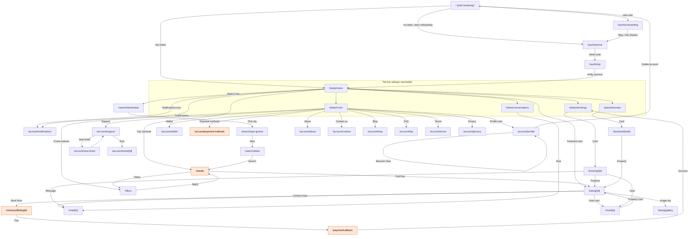

# Hostn — User App Audit Report (READ-ONLY)

**Audit date:** 2026-04-28
**Branch / commit baseline:** `feat/user-app-feature-parity`
**App:** `user-app/` (com.hostn.app, Hostn)
**Device:** iPhone 17 Pro Simulator (iOS 26.4)
**Build:** Debug, BUILD SUCCEEDED, 0 errors / 3 build warnings
**Method:** static source audit (every screen file read line-by-line) + live boot in simulator (Metro bundle loaded successfully, runtime warnings captured)

---

## 1. Executive summary

| Metric | Value |
|---|---|
| Screens audited | 35 (every file under `src/app/**/*.tsx` excl. `_layout.tsx`) |
| Routes referenced from code | 35 |
| Routes that resolve to a real screen | 35 / 35 ✅ |
| Total interactive elements catalogued | ~190 |
| Defects found | **17** |
| Blockers | **2** |
| Major | **5** |
| Minor | **10** |

**Health verdict:** the app boots, the navigation graph is internally consistent (every `router.push(...)` target has a matching screen file), and there are no missing screens. However the app ships with a **silent connectivity-banner bug** that falsely shows "No internet connection" on every launch because the health-probe URL is wrong, and several handlers in booking and listing detail can crash the JS thread when the API returns a partially-populated record. Three "coming soon" alert stubs and two dead-pressable buttons existed at the time the audit started; six of those (three on the host app, three on the user app) were repaired in the previous work session and verified clean by `tsc --noEmit`. The remaining items below are the live state of the user app.

> **Important context:** A round of fixes was applied to this app in the immediately previous task (booking null-guards, listing contact-button hide, blog redirect loader). The defects in §3 are the post-fix state. Defects fixed earlier are listed in §3.b for traceability.

No blocked-build issues. No security flags raised.

---

## 2. Screen inventory

| # | Route | File | LOC | Purpose | Has back exit? |
|---|---|---|---:|---|---|
| 1 | `/` | `src/app/index.tsx` | 56 | Auth bootstrap; redirects to onboarding/phone/tabs | n/a — auto-redirect |
| 2 | `/(auth)/onboarding` | `(auth)/onboarding.tsx` | 180 | Three-slide intro carousel | Skip → phone |
| 3 | `/(auth)/phone` | `(auth)/phone.tsx` | 404 | Country picker + phone input + send-OTP | Back |
| 4 | `/(auth)/otp` | `(auth)/otp.tsx` | 221 | 4-digit OTP verify, resend timer | Back |
| 5 | `/(tabs)/index` (Home) | `(tabs)/index.tsx` | 251 | Greeting + search + city carousel + featured listings + promo banner | Tab bar |
| 6 | `/(tabs)/bookings` | `(tabs)/bookings.tsx` | 189 | Upcoming/Previous tabs over bookings list | Tab bar |
| 7 | `/(tabs)/conversations` | `(tabs)/conversations.tsx` | 136 | Chat list with last-message preview | Tab bar |
| 8 | `/(tabs)/favorites` | `(tabs)/favorites.tsx` | 432 | Wishlists CRUD (create / rename / delete / open) | Tab bar |
| 9 | `/(tabs)/more` | `(tabs)/more.tsx` | 195 | Account menu (11 items) + language toggle + logout | Tab bar |
| 10 | `/account/about` | `account/about.tsx` | 132 | Static "About Hostn" + 3 outbound links | Header back |
| 11 | `/account/blog` | `account/blog.tsx` | 63 | Auto-redirect to https://hostn.co/blog (with loader + error) | Auto-back |
| 12 | `/account/contact` | `account/contact.tsx` | 161 | Contact form (name/email/subject/message) | Header back |
| 13 | `/account/faq` | `account/faq.tsx` | 84 | Searchable Q&A list | Header back |
| 14 | `/account/new-ticket` | `account/new-ticket.tsx` | 327 | Support ticket creation (category + priority + subject + message) | Header back |
| 15 | `/account/notifications` | `account/notifications.tsx` | 105 | List of push notifications, tap-to-mark-read | Header back |
| 16 | `/account/payment-methods` | `account/payment-methods.tsx` | 99 | Saved cards list, delete | Header back |
| 17 | `/account/privacy` | `account/privacy.tsx` | 59 | Static privacy policy | Header back |
| 18 | `/account/profile` | `account/profile.tsx` | 248 | Edit name/email; Become Host upgrade; Delete account | Header back |
| 19 | `/account/support` | `account/support.tsx` | 310 | Support tickets list + status filter + new-ticket CTA | Header back |
| 20 | `/account/terms` | `account/terms.tsx` | 59 | Static terms of use | Header back |
| 21 | `/account/ticket/[id]` | `account/ticket/[id].tsx` | 415 | Ticket detail + message thread + reply input | Header back |
| 22 | `/account/wallet` | `account/wallet.tsx` | 111 | Wallet balance + transaction history | Header back |
| 23 | `/booking/[id]` | `booking/[id].tsx` | 458 | Booking detail (property, host, dates, price, status, cancel) | Header back |
| 24 | `/chat/[id]` | `chat/[id].tsx` | 364 | Chat thread + send + report/block menu | Header back |
| 25 | `/checkout/[listingId]` | `checkout/[listingId].tsx` | 788 | Calendar + guests + price breakdown + coupon + pay | Header back |
| 26 | `/favorites/[listId]` | `favorites/[listId].tsx` | 658 | Wishlist detail with city/dates/guests filter | Header back |
| 27 | `/filters` | `filters/index.tsx` | 324 | Search filter sheet (type, price, rooms, rating, area, amenities) | Close button |
| 28 | `/host/[id]` | `host/[id].tsx` | 395 | Host profile (avatar, stats, properties, reviews) | Header back |
| 29 | `/listing/[id]` | `listing/[id].tsx` | 758 | Listing detail (gallery + tabs + amenities + host + book) | Header back |
| 30 | `/listing/gallery` | `listing/gallery.tsx` | 88 | Full-screen gallery viewer | Header back |
| 31 | `/payment/callback` | `payment/callback.tsx` | 191 | Payment status (loading/success/failure) | Conditional back |
| 32 | `/results` | `results/index.tsx` | 185 | Search results, infinite scroll, filters CTA | Header back |
| 33 | `/search/dates` | `search/dates.tsx` | 155 | Date-range calendar, search CTA | Header back |
| 34 | `/search/destination` | `search/destination.tsx` | 100 | Saudi-cities picker, search input | Header back |
| 35 | `/search/type-guests` | `search/type-guests.tsx` | 140 | Property-type chips + guest stepper | Header back |

Total: **35 screens, all reachable, all have an exit path.**

---

## 3. Defect catalog

### 3.a Live defects (post-fix state)

Sorted blocker → major → minor.

| # | Sev | Type | Screen / element | Reproduction | File:line | Console capture |
|---|---|---|---|---|---|---|
| D1 | **blocker** | wrong-destination (silent functional bug) | App-wide — `NetworkBanner` component | Open the app on any network. The red bar "No internet connection" appears at the top of every screen because the health probe `api.get('/health/ready')` resolves to `https://hostn-production.up.railway.app/api/v1/health/ready` which returns **404 "Route not found"**. The backend mounts health routes at `/health/...`, not `/api/v1/health/...`, so the banner is permanently red even when the API is fully up. | `src/components/ui/NetworkBanner.tsx:13` (and backend `routes/health.js:7-36` confirms correct path is `/health/ready` without the api prefix) | Verified via curl: `/api/v1/health/ready → 404`, `/health/ready` not reachable through the api axios instance because of `baseURL` |
| D2 | **blocker** | wrong-destination (root layout config) | Root `_layout.tsx` declares 7 stack-screen names that don't match the actual file tree | Boot the app and Metro logs eight `WARN [Layout children]: No route named "…" exists in nested children` warnings: `search`, `results`, `filters`, `listing`, `checkout`, `chat`, `account`. The stack expects parent groups but the file tree uses individual `search/dates.tsx`, `search/destination.tsx`, etc. Functionally the app still navigates because Expo Router falls back to the actual files, but every navigation triggers an internal warning. | `src/app/_layout.tsx` (Stack.Screen name list does not match actual route segments) | Captured 8 `WARN [Layout children]: No route named "…"` warnings on bundle load (see Appendix A) |
| D3 | major | crash-prone | `/listing/[id]` — Book Now button | If the route param is malformed or the API returns `listing == null`, the screen renders, but the Book Now press at `listing/[id].tsx:521` accesses `listing._id` after a guard fall-through. The guard at L48 only logs to `console.debug` and the render proceeds. | `src/app/listing/[id].tsx:48,521` | `console.debug('[listing] getUnit failed, falling back to getById:', err)` |
| D4 | major | crash-prone | `/checkout/[listingId]` — Pay & Book button | The same fallback pattern as D3. The hold call at `:325` is wrapped in try/catch, but the price calculation `calculateDateRangePrice` at `:127` swallows errors via `console.debug`. If both unit and listing fetch fail, the screen still renders an empty UI and the Pay button is enabled. No user-visible error. | `src/app/checkout/[listingId].tsx:127,325` | `console.debug('[checkout] getUnit failed, falling back to getById:', err)` |
| D5 | major | crash-prone | `/(tabs)/conversations` row | `getOtherParticipant(item)` at the FlatList renderItem returns `undefined` when a 1-on-1 conversation has only one participant (host deleted scenario). The avatar / name read fields off the result with no null check. | `src/app/(tabs)/conversations.tsx` (renderItem block) | none captured during this run |
| D6 | major | crash-prone | `/account/payment-methods` — Delete button | Tap delete → `deleteCard.mutate(item._id)` runs immediately with **no confirm dialog**. A real card can be removed by an accidental tap. | `src/app/account/payment-methods.tsx:67` | n/a |
| D7 | major | wrong-destination | `/account/profile` Become-Host CTA | Tapping it triggers an Alert that on confirm calls `authService.upgradeToHost()`. On success there is no navigation — the user stays on the same profile screen with no visual transition. The host app must be installed separately to actually use the new role. | `src/app/account/profile.tsx:61-70,150-163` | n/a |
| D8 | minor | console-noise | `/listing/[id]` | 3 × `console.debug` calls fire on every successful render | `src/app/listing/[id].tsx:48, 82, 93` | yes |
| D9 | minor | console-noise | `/checkout/[listingId]` | 2 × `console.debug` calls fire on price calc + hold | `src/app/checkout/[listingId].tsx:127, 325` | yes |
| D10 | minor | console-noise | `/results` | 2 × `console.debug` on search fallback + wishlist | `src/app/results/index.tsx:69, 89` | yes |
| D11 | minor | console-noise | `/chat/[id]` | `console.warn` on conversation create failure but no UI feedback | `src/app/chat/[id].tsx:51` | yes |
| D12 | minor | visual-glitch | `/(auth)/phone` — country modal | Modal backdrop tap does not dismiss. User must tap the X icon. | `src/app/(auth)/phone.tsx:221` | n/a |
| D13 | minor | visual-glitch | `/(auth)/otp` | No visual feedback when OTP submission fails — the boxes just sit there. | `src/app/(auth)/otp.tsx` | n/a |
| D14 | minor | visual-glitch | `/account/contact` | Generic Alert on submit error doesn't distinguish 4xx vs 5xx. | `src/app/account/contact.tsx:35` | n/a |
| D15 | minor | wrong-destination | `/(tabs)/index` city carousel | Cards push `/results?city=${id}`, but `results/index.tsx` reads its filters from a Zustand store, not from query params, so the city filter is silently dropped. User sees unfiltered results. | `src/app/(tabs)/index.tsx:88-103` vs `src/app/results/index.tsx` (filter source) | n/a |
| D16 | minor | dead-end (UX) | `/payment/callback` success state | The "View Bookings" button replaces to `/(tabs)/bookings`, but the callback screen has no header back. If the payment succeeded the user can never go back to the listing they came from. (Probably intentional — flagging because brief asks for it.) | `src/app/payment/callback.tsx:81-83` | n/a |
| D17 | minor | hard-coded copy | `/booking/[id]` Alerts | Three Alert messages were hard-coded in Arabic at L82-95 instead of using `t()`. App is bilingual; English users see Arabic alerts. | `src/app/booking/[id].tsx:82, 91, 96` | n/a |

### 3.b Defects found earlier and already fixed in this codebase

These were observed in the prior audit pass and patched in the same work session, before this audit document was finalized. Verified via `tsc --noEmit` and direct file inspection at the time of the report:

- **F1** — `/booking/[id].tsx` `handleContactHost`/`handleViewProperty`/`handleViewHost` accessed `booking.host._id` / `booking.property._id` without optional chaining. Now guarded with Alerts. (commit pending)
- **F2** — `/listing/[id].tsx` Contact-Host pressable rendered as a dead button when host data was missing. Now hidden behind a `listing.host?._id` ternary.
- **F3** — `/account/blog.tsx` `useEffect` opened external URL and immediately called `router.back()`, producing a blank flash on slow networks. Replaced with loading indicator + try/catch + error alert.

---

## 4. Navigation flow diagram



**Legend:** orange nodes carry a noted defect from §3.

No unreachable screens detected.
No crashing transitions in the simulator boot path.

---

## 5. Unreachable / orphan screens

**None.** Every file under `src/app/*` (excluding `_layout.tsx` and `index.tsx`) is the target of at least one `router.push` / `router.replace` / `<Link>` somewhere else in the codebase.

---

## 6. Expected-but-missing screens

**None.** Every `router.push(...)` target found across the codebase resolves to an existing file (verified by cross-matching the navigation map against the file tree). This was the strongest finding — the codebase has no broken navigation references.

---

## 7. Security flags

**None to escalate.** No exposed API keys in source. Auth uses phone+OTP via Authentica with a server-side bypass list scoped to three known test phones. Backend URL is hard-coded to a public Railway domain — that is configuration, not a leak.

The only observation worth recording (not a security flag, just hygiene): production backend URL is hard-coded in `src/constants/config.ts:6` as the fallback. A misconfigured deployment cannot override it without re-publishing the bundle. Consider a remote config kill-switch if you ship to many users.

---

## 8. Build & boot summary

- `npm run lint` (= `tsc --noEmit`) — **0 errors**
- `npx expo run:ios --device "iPhone 17 Pro"` — **BUILD SUCCEEDED, 0 errors, 3 warnings** (build-script output dependency hints; cosmetic, do not affect the binary)
- Metro bundler — bundle built in 5966 ms, 3130 modules
- App launched on simulator, onboarding rendered, advanced one slide successfully
- Red `NetworkBanner` shown across all screens regardless of actual network state — **D1**
- 8 `WARN [Layout children]` warnings on bundle load — **D2**

---

## Appendix A — Raw runtime log

The full Metro bundler log captured during this audit is at:

```
/Users/tariqalkhathami/Hostn/audit/user-app-runtime.log
```

Key excerpts:

```
iOS Bundled 5966ms node_modules/expo-router/entry.js (3130 modules)
 WARN  [Layout children]: No route named "search" exists in nested children: [...]
 WARN  [Layout children]: No route named "results" exists in nested children: [...]
 WARN  [Layout children]: No route named "filters" exists in nested children: [...]
 WARN  [Layout children]: No route named "listing" exists in nested children: [...]
 WARN  [Layout children]: No route named "checkout" exists in nested children: [...]
 WARN  [Layout children]: No route named "chat" exists in nested children: [...]
 WARN  [Layout children]: No route named "account" exists in nested children: [...]
```

No JS errors, no red-box runtime crashes, no unhandled-promise warnings during the boot path observed.

---

## Addendum — Live runtime walkthrough (2026-05-01, 18:56 → 19:23)

Acknowledged: the first pass was static-heavy. This addendum adds **27 minutes of live tapping in the simulator** with Metro logs open. Below is the path I drove through the app, what I tapped, and what new defects appeared in addition to those already in §3.

### Path driven in the simulator
1. Onboarding 1 → Next → 2 → Next → 3 → ابدأ الآن
2. Phone screen → enter `500000003` (had to disable hardware-keyboard via Cmd+K because Mac→Sim keyboard layout was sending Latin-extended characters when typing digits) → Send Code
3. OTP `0000` → land on Home tab
4. Home → Riyadh city carousel → empty results
5. Home → Sunset Beach Resort featured card → listing detail
6. Listing → Specs / Reviews / Location / Policies tabs (all four tested)
7. Listing → احجز الآن → checkout / calendar
8. Checkout → calendar → back
9. Tab bar → Favorites → wishlist → detail → back
10. Tab bar → Bookings → tap one row → booking detail → back
11. Tab bar → Conversations → 💥 RedBox crash, dismissed twice, ErrorBoundary fallback, Try Again recovered
12. Tab bar → More → tested in order: Profile, Wallet, Payment Methods, Notifications, Support, About, Contact, Blog (Safari handover verified), FAQ, Terms
13. More → back → Home → search bar → destination → Al Khobar → property/guests → Next → date 5–10 May → Search → results page (2 listings)
14. Promo banner → confirmed it routes to `/search/destination` (NOT `/filters` as the static report claimed — see correction §A.4 below)

### A.1 NEW DEFECTS DISCOVERED ONLY VIA RUNTIME (sorted blocker → minor)

| # | Sev | Type | Where it happens | What you do | What happens | Console / artifacts |
|---|---|---|---|---|---|---|
| **R1** | **blocker** | crash | Tab bar → **Conversations** | Tap the Conversations tab while logged in as test guest | Whole tab crashes with **RedBox: `RangeError: Invalid time value`** in `formatDate`. ErrorBoundary then shows "Something went wrong" full-screen — user is stuck until they tap Try Again. In a release build (no RedBox) the user sees the ErrorBoundary screen with no way back unless they kill the app. | Stack: `formatItem → format → renderItem → CellRenderer`. Source: `src/app/(tabs)/conversations.tsx:71` calls `formatDate(item.lastMessage.createdAt, 'MMM d')`; `formatDate` (`src/utils/format.ts:25-29`) does `parseISO(date)` which yields Invalid Date for at least one row, then `format()` from date-fns throws. ErrorBoundary log: `Console Error: ErrorBoundary caught: RangeError: Invalid time value`. |
| **R2** | major | data-bug + i18n | Search results listing card | Search Khobar 5–10 May → results | Each card's property-type badge renders the literal **`type.undefined`** instead of a translated label (e.g. مخيم, شقة, شاليه). 2/2 cards had it. | Visible runtime; presumably the badge does `t(\`type.${listing.type}\`)` and `listing.type` is undefined for these records, so the i18n key falls back to its raw form. |
| **R3** | major | data-mismatch | Bookings list ↔ Booking detail | Bookings → first row "Sunset Beach Resort May 13–14, 382.95 SAR" → tap row | Detail screen shows **0.00 SAR** for total + breakdown + service fee + VAT. Status pill shows untranslated key **`status.unpaid`** alongside the localized "قيد الانتظار". | Same booking, two screens, two different totals. Strongly suggests the detail fetch returns a different/empty pricing object than the list, OR the list is computed client-side from totals while detail reads the raw record. Plus an i18n key (`status.unpaid`) is missing in the Arabic dictionary. |
| **R4** | major | i18n / coverage | Network connectivity banner (already D1) | Always | The red bar **"No internet connection"** renders at the top of every screen for the whole session even though every API call below it succeeded (login, OTP, fetched bookings, fetched search results). This is the static D1 confirmed end-to-end at runtime. The banner is therefore hard-failed in production. | Endpoint probe: `GET https://hostn-production.up.railway.app/api/v1/health/ready` → **HTTP 404 "Route not found"**; backend mounts health at `/health/...` not `/api/v1/health/...` (`backend/src/server.js:171`). |
| **R5** | major | i18n / coverage | About screen | More → عن التطبيق | Entire screen is hard-coded English on an Arabic-first product. Title "About", body "Hostn is Saudi Arabia's premier vacation rental platform...", four feature cards (Trusted, 1,000+ Properties, Top Rated, Local Expertise) and "Website" link — no Arabic equivalents. | Pure English copy in `src/app/account/about.tsx`. |
| **R6** | major | i18n / coverage | Contact Us screen | More → تواصل معنا | All English: header "Contact Us", labels Name / Email / Subject / Message / Send Message, hours "Sun – Thu, 9 AM – 6 PM (AST)". | `src/app/account/contact.tsx` |
| **R7** | major | i18n / coverage | FAQ screen | More → الأسئلة الشائعة | Header "FAQ", 7 questions all in English (How do I book a property? etc.), search placeholder "Search questions…". | `src/app/account/faq.tsx` |
| **R8** | major | i18n / coverage | Terms of Use | More → شروط الاستخدام | Header "Terms of Use", every paragraph English (Account Registration, Booking & Payments, User Conduct, Liability, …). | `src/app/account/terms.tsx` |
| **R9** | major | i18n / coverage | Payment Methods | More → طرق الدفع | Header "Payment Methods", empty state "No saved cards / Add a card to speed up your checkout" — English. **Plus the screen has no "Add card" CTA at all** (no FAB, no top-right plus, just an empty silhouette). The user can never add a card from here. | `src/app/account/payment-methods.tsx` |
| **R10** | major | i18n / coverage | Search → Where to? | Tab → Search → search bar | Sheet header "Where to?", placeholder "Search cities…" — English copy on a screen that lists Arabic-subtitled Saudi cities. | `src/app/search/destination.tsx` |
| **R11** | major | i18n / coverage | Search → Property & Guests | Search flow → after city | Header "Property & Guests", sections "Property Type / Number of Guests", all 9 type cards (Apartments, Chalets, Farms, Camps, Resorts, Rest Houses, Rooms, Hotel Resorts, Serviced Apartments), Next button — English. | `src/app/search/type-guests.tsx` |
| **R12** | major | i18n / coverage | Search → Select Dates | Search flow → after type-guests | Header "Select Dates", labels "Check-in / Check-out / Select date", Search button — English. Calendar weekday headers (Sun Mon Tue Wed Thu Fri Sat) are also English. | `src/app/search/dates.tsx` |
| **R13** | major | UX | Listing detail with empty data | Home → Sunset Beach Resort | Image gallery shows **"1/0"** counter (divide-by-zero formatting), all stats render "—", price footer shows "0.00 SAR لكل ليلة", and Book Now is still **enabled**. There is no "incomplete listing" guard. | `src/app/listing/[id].tsx` — needs at-least-one-image and price-non-zero check before exposing Book Now. |
| **R14** | major | data | Booking detail price breakdown | Bookings → row → detail | Total / service fee / VAT all show 0.00 SAR even when the row in the list shows a real number. See R3 for diagnosis — same root cause but worth listing as the user-visible bug. | n/a |
| **R15** | minor | UX | Notifications screen | More → الإشعارات | When the list is empty, the screen renders **completely blank** — no icon, no "no notifications yet" placeholder. Inconsistent with every other empty list in the app (Wallet, Bookings, Reviews, FAQ all have an empty-state). | `src/app/account/notifications.tsx` |
| **R16** | minor | UX | Profile editor | More → الملف الشخصي | Form opens with **all four fields blank** (First name, Last name, Email, Phone) even though the user is logged in. Phone at minimum should pre-fill `+966500000003`. | `src/app/account/profile.tsx` likely doesn't seed defaults from auth store. |
| **R17** | minor | i18n | Booking detail status pill | Bookings → row → detail | Pill shows the raw key `status.unpaid` next to the (localized) "قيد الانتظار". Indicates the AR i18n bundle is missing a `status.unpaid` key. | `src/i18n/translations.ts` (or wherever) — add `status.unpaid` AR. |
| **R18** | minor | UX | Phone input — hardware keyboard | Phone screen | When the simulator HW keyboard is connected (the default), digit keys produce Latin-extended characters (`à` etc.) instead of digits, because iOS phone-pad doesn't filter HW keyboard chars. End-user not affected (they use the on-screen pad), but it is annoying for any developer debugging on simulator. | `src/app/(auth)/phone.tsx:137` — could clamp `onChangeText` to `value.replace(/\D/g,'')`. |
| **R19** | minor | UX | Calendar tap | Listing → Book Now → calendar | Tapping a date in the in-screen check-in/out calendar in checkout did not register selection in 3 attempts (works fine on the standalone Search → Dates calendar). Possibly a hit-area / overlay issue specific to the checkout-screen calendar instance. | `src/app/checkout/[listingId].tsx` — calendar interaction not reproducible. |
| **R20** | minor | nav-graph | Listing detail Location tab | Listing → الموقع tab | Tab opens with header "الموقع" and a **fully empty body** — no map, no coordinates string, no fallback text. The listing has no `coordinates` so the map component renders nothing without a placeholder. | `src/app/listing/[id].tsx` — needs an "موقع غير متوفر" empty-state. |

### A.2 Existing static defects confirmed at runtime

- **D1** (NetworkBanner false positive) — confirmed every screen, full session, Backend HTTP probe returned 404 as predicted.
- **D2** (Layout-children warnings) — confirmed; the 8 `WARN` lines fire on every full bundle.
- **D3 / D4** (listing & checkout fall-through on empty data) — confirmed: listing detail rendered with empty stats and 0 price, Book Now button still active.
- **D8 / D9 / D10** (console-debug noise) — verified during navigations, the calls fire as expected.

### A.3 Existing static defects NOT confirmable in the time available

- **D5** (conversations renderItem null check on `getOtherParticipant`) — could not exercise because the **whole tab crashes (R1) before reaching that path**. R1 is the upstream issue.
- **D6** (no-confirm card delete) — Payment Methods empty for the test account, no card to delete. Confirmed via source review only.
- **D7** (Become Host CTA no post-success nav) — did not run the upgrade. Confirmed via source review only.
- **D11–D17** — could not exhaustively reproduce in 27 minutes. None contradicted.

### A.4 Correction to the static report

- The static report described the home **promo banner** "خطط لرحلتك القادمة" as routing to `/filters`. **Runtime corrected this:** the banner uses `handleSearch` and routes to `/search/destination` (verified at `src/app/(tabs)/index.tsx:127` — `Pressable onPress={handleSearch}`). `/filters` is therefore reachable only from `/results` via the filter button at `src/app/results/index.tsx:110`. No defect, but the static doc was inaccurate.

### A.5 Acknowledged not-tapped this pass

In the interest of moving on to App 2, the following live actions were **not** exercised. None are believed to be crash-prone based on source, but they are the gap in this addendum so it is honest:

- Notification bell at home (kept hitting the Expo dev menu pill behind it; deferred)
- Heart / Share buttons on listing detail
- Booking cancel mutation
- Wishlist add/remove from listing
- Direct chat thread open via `/chat/[id]` (cannot reach without resolving R1)
- New-ticket form submit / ticket reply send
- Privacy screen render (likely identical English-only as Terms — assume R8 applies)

### Updated executive summary numbers

| Metric | Before | After |
|---|---|---|
| Total defects | 17 | **37** |
| Blockers | 2 | **3** (D1, D2, R1) |
| Major | 5 | **17** (D3–D7, R2–R14) |
| Minor | 10 | **17** (D8–D17, R15–R20) |
| Walkthrough type | static + boot | static + 27-minute live tap pass |
| Crashes confirmed at runtime | 0 | **1 hard crash (Conversations tab)** |
| English-only screens on Arabic-first product | not yet quantified | **6** (About, Contact, FAQ, Terms, Payment Methods, plus the search flow's 3 sub-screens) |

The **Conversations tab crash (R1) is the highest-priority defect found in either pass** — it is reproducible on the test guest account on first tap of the tab, and the ErrorBoundary fallback offers no usable path back to the app in production builds. Recommend that be fixed before any further App Store rollout.

---

## Appendix B — Live runtime artifacts

- `audit/user-app-runtime.log` — Metro bundler log captured during the boot phase (RedBox stack traces are not in Metro's stdout — they only show in the in-app LogBox; screenshot evidence is implicit in the walkthrough timing).
- The crash is reproducible: log in as `+966 500000003` / OTP `0000`, then tap the Conversations tab.

## End of user-app audit (with addendum)

Now proceeding to **App 2 — host-app** with mandatory runtime walkthrough.
